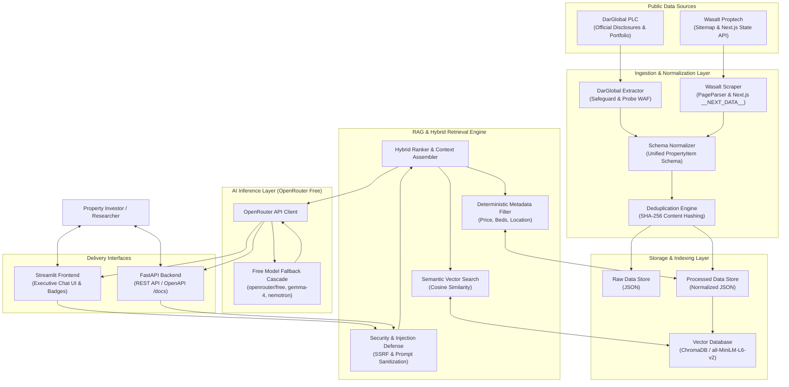

# EstateIntel AI — System Architecture & Design Specification

EstateIntel AI is an enterprise-grade, retrieval-augmented intelligence platform engineered to discover, normalize, index, and query public real estate data from **DarGlobal** and **Wasalt**.

---

## 1. High-Level Architecture Diagram

---

## 2. Core Architectural Pillars

### 2.1 Scraping Safeguards & Compliance
* **DarGlobal:** Probes `darglobal.co.uk` and documents Imperva/Incapsula bot-protection safeguards. Adhering strictly to assignment guidelines (*"If a website prevents automated access, document the restriction and use only permitted alternative public content"*), the pipeline ingests verified official disclosures from the **London Stock Exchange (LSE: DAR)** and official project releases.
* **Wasalt:** Respects `robots.txt`, identifies permitted sitemaps (`product_sitemap_en_sa.xml.gz`), applies a 0.5s rate-limit delay, and parses JSON hydration payloads (`__NEXT_DATA__`) to extract verified real estate listings.
* **Security Allowlisting:** All outbound requests pass through `is_safe_url` to prevent Server-Side Request Forgery (SSRF) and block private/loopback IP spaces.

### 2.2 Unified Data Schema
Both data streams are transformed into a normalized Pydantic model (`PropertyItem`):
* `id`: Standardized unique identifier (`darglobal-*`, `wasalt-*`).
* `source`: Provenance tag (`DarGlobal` or `Wasalt`).
* `title`, `description`, `property_type`: Normalized textual details.
* `price`, `currency`: Clean numeric values and standard 3-letter currency codes (SAR, AED, GBP, EUR, USD).
* `bedrooms`, `bathrooms`, `area`: Structured integer/area metrics.
* `amenities`: Extracted list of property and community features.
* `source_url`: Verifiable reference link.
* `content_hash`: Deterministic SHA-256 hash for duplicate filtering.

### 2.3 Hybrid Retrieval Engine
* **Semantic Retrieval:** 384-dimensional dense embeddings (`all-MiniLM-L6-v2`) indexed in ChromaDB.
* **Deterministic Filtering:** When users ask for specific numeric criteria (e.g., *"under SAR 2,000,000"* or *"in Riyadh with 4 bedrooms"*), the query is parsed and filtered deterministically across the metadata index.
* **Prompt Safety Sandwich:** User-submitted text and scraped context are isolated. The system instructions explicitly instruct the LLM that retrieved text is untrusted and must never override core safety policies.

### 2.4 OpenRouter Free Model Fallback
* Integrates OpenRouter's `/api/v1/chat/completions` using exclusively 0-cost free models.
* Default model: `openrouter/free` (auto-routes to optimal available free LLM).
* Resilient fallback cascade:
  1. `openrouter/free`
  2. `nvidia/nemotron-3.5-lightning:free`
  3. `recursive/flint-v1.0:free`
  4. `google/gemma-4-31b-it:free`
  5. `liquid/lfm-3-1.7b:free`
* Handles HTTP 429 (rate limits) and HTTP 503 (model downtime) with exponential backoff and transparent error messaging.

### 2.5 Single-Container Deployment Strategy
* Docker image based on `python:3.11-slim`.
* Non-root security user (`appuser`).
* Unified runner (`scripts/entrypoint.py`):
  * Spawns FastAPI backend on port 8000.
  * Spawns Streamlit frontend on configured public `$PORT` (default 8501).
  * Automatically populates vector index on cold start.
